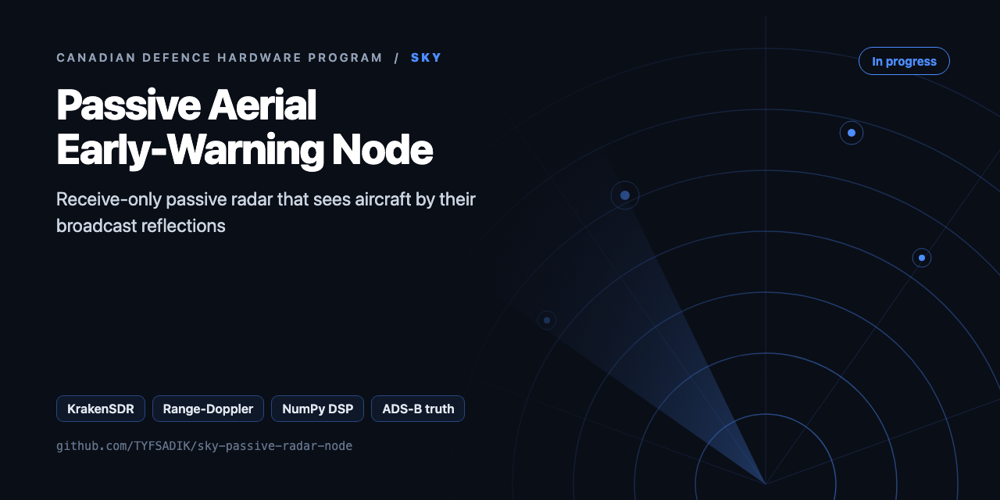
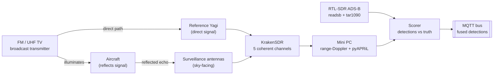

<div align="center">



# Sky: Passive Aerial Early-Warning Node

**Receive-only passive radar on a KrakenSDR 5-channel coherent SDR: broadcast reflections off aircraft, range-Doppler processing, scored against ADS-B truth.**

[](https://github.com/TYFSADIK/sky-passive-radar-node/actions/workflows/tests.yml)   [](LICENSE) [](https://github.com/TYFSADIK/defence-hardware-program)

[Build guide](docs/project-page.md) · [How it works](#how-it-works) · [Quick start](#quick-start) · [Program hub](https://github.com/TYFSADIK/defence-hardware-program)

</div>

## Overview

Canada's **Arctic Over-the-Horizon Radar** (A-OTHR), based on Australia's JORN design, adapted for RCAF/NORAD, with initial capability due December 2029, will provide long-range early-warning coverage of the northern approaches as one layer in a sensor picture that also includes conventional radar, airborne, and space-based sensors. Its companion program, **Crossbow**, is a classified Canada-US non-radar sensor network. You can't copy Crossbow, and you shouldn't try.

What you *can* build is the open, hobby-scale, receive-only analogue: a **passive radar node**. Instead of transmitting its own pulses, passive radar listens to reflections of existing broadcast signals, FM radio (88-108 MHz) and UHF TV (~470-600 MHz), bouncing off aircraft. Because the radar front end only receives, it needs no transmit licence, radiates nothing of its own to give away a position, and is cheap. The export-control and intercept-law checks that still apply are covered in the notes at the bottom. A KrakenSDR gives me five phase-coherent receive channels, which is enough to point one antenna at the broadcast transmitter (the **reference** channel) and the rest at the sky (the **surveillance** channels), then cross-correlate the two to find echoes.

This is Phase 1 of my [Canadian Defence Hardware Program](https://github.com/TYFSADIK/defence-hardware-program). It is the flagship sky-domain node: every detection it makes will eventually publish over MQTT into the multi-domain common operating picture, fused with the water and ground nodes.

## How it works



*The transmitter is someone else's; the node only receives. Reference and surveillance channels cross-correlate into range-Doppler detections, which are scored against independent ADS-B truth before publishing to the fusion bus.*

## Quick start

```bash
pip install -r requirements.txt
python demo.py && python -m unittest -v
```

Real output from the demo, run on simulated data:

```text
raw : 0 peaks, matched [], missed ['C-GABC', 'C-FXYZ'], false 0
ECA : 2 peaks, matched ['C-FXYZ', 'C-GABC'], missed [], false 0
      C-GABC: range 14.4 km, doppler +80.0 Hz, 19.6 dB
      C-FXYZ: range 32.4 km, doppler -55.0 Hz, 18.0 dB
range resolution c/B = 1499 m (FM 200 kHz)
```

## What's in this repo

| File | Purpose |
|---|---|
| `pradar/signals.py` | Synthetic scene: band-limited broadcast, direct path, 0-Hz clutter, delayed and Doppler-shifted targets |
| `pradar/eca.py` | **ECA** least-squares clutter cancellation, batched (ECA-B), optional Doppler columns (ECA-S style) |
| `pradar/caf.py` | Cross-ambiguity function with the **batches algorithm** (FFT range per batch, FFT across batches for Doppler) |
| `pradar/cfar.py` | **2D CA-CFAR** using summed-area tables, threshold from the design Pfa, zero-Doppler ridge excluded |
| `pradar/truth.py` | WGS-84 → ECEF, bistatic range and Doppler from ADS-B (lat, lon, alt, gs, track, vrate), gated association |
| `pradar/krakensdr.py` | Placeholder for the KrakenSDR heimdall DAQ input |

## What you need

| Category | Item | Notes |
|----|----|----|
| Hardware | KrakenSDR | 5-channel coherent SDR, 5x R820T2 tuners, 24 MHz to 1766 MHz, 2.56 MHz channel bandwidth, ~11 W at 5 V |
| Hardware | Reference + surveillance antennas | FM Yagi for the reference channel, log-periodic/whip surveillance antennas, matched-length coax, NanoVNA for tuning |
| Hardware | Mini PC (Ubuntu) | Intel N100/i5 class with 16 GB RAM; keep the two SDRs on separate USB controllers |
| Hardware | RTL-SDR Blog V4 + 1090 MHz antenna | The ADS-B ground-truth receiver; its data is what makes every radar result scoreable |
| Software | KrakenSDR DAQ/DSP + pyAPRiL | Open-source KrakenRF software for capture, pyAPRiL for range-Doppler processing |
| Software | readsb + tar1090, rtl_power | Aircraft truth map and spectrum survey tooling, both free |
| Software | chrony, Python/numpy/scipy | NTP time discipline for truth alignment, numerical stack for the chain |
| Skills | RF fundamentals, Linux, Python DSP | dB arithmetic, gain staging, reading waterfall plots, coherent vs non-coherent captures |
| Accounts | None for receive-only | No accounts or licenses needed; export-control review with Global Affairs Canada is required before publishing radar processing code |

## Status

- **Done**: full BOM purchased and on the bench; ADS-B ground-truth receiver (readsb + tar1090) live with continuous position logging; FM and UHF TV illuminator survey with rtl_power; Yagi and log-periodic tuned with the NanoVNA; KrakenSDR streaming coherent IQ with the calibration discipline (recalibrate on every retune) in place; capture recorder writing CF32 plus metadata sidecars.
- **In progress**: pyAPRiL range-Doppler chain with ECA clutter filtering tuned against recorded captures; the T2 calibration-hold and T3 FM detection test runs; the scoring harness that aligns CFAR hits with the ADS-B truth log.
- **Next**: finish the T3-T5 scoring runs and publish the per-illuminator dataset (detection rate, false-alarm rate, effective range); systemd-managed always-on node with MQTT publishing; second node and the T6 multi-node fusion dry run into the common operating picture; export-control review with Global Affairs Canada before any radar code is published.

| Metric | Target | Measured to date | Current status |
|----|----|----|----|
| ADS-B truth log uptime | \> 95% over any scoring week | Running; uptime tracked, scoring weeks being selected | Running; uptime tracked, scoring weeks being selected |
| Detection rate (FM illuminator) | \> 70% of ADS-B tracks in the primary coverage band | Not yet measured | In progress, T3 runs underway, not yet scored |
| Detection rate (UHF TV illuminator) | Comparable to FM within its coverage band | Not yet measured | Not yet measured, T4 pending |
| False-alarm rate | \< 10 per hour at the working CFAR threshold | Not yet measured | In progress, clutter filter still being tuned |
| Effective bistatic range | Establish per illuminator, then publish | Not yet measured | Not yet measured, follows from T3/T4 |
| Calibration hold time | Quantify, then automate re-calibration on that interval | Not yet measured | In progress, T2 data being collected |
| Multi-node position error | Meaningfully better than single-node geometry | Not yet measured | Not started, second node not yet built |

## Roadmap

- [ ] Wire `krakensdr.py` to the heimdall DAQ stream, using ch0 as the reference and ch1-4 as surveillance
- [ ] T3 (FM, about 1500 m resolution) vs T4 (ATSC 6 MHz, about 50 m): run the same airspace on both illuminators
- [ ] Use the four surveillance channels for angle of arrival (MUSIC on the target cell) to get position, not just bistatic range
- [ ] Track across CPIs (a Kalman filter in range and Doppler) before scoring, then report Pd vs ADS-B per range bin
- [ ] Move the CAF to the GPU (CuPy) or a C++/FFTW worker if the Pi can't keep up in real time

## Related builds

- [Multi-Domain Common Operating Picture](https://github.com/TYFSADIK/multi-domain-common-operating-picture), where this node's detections end up: fused with the water and ground nodes over MQTT with a human deciding.
- [Passive Acoustic Drone Detector](https://github.com/TYFSADIK/acoustic-drone-detector), the other receive-only sky sensor in the program, listening for rotor harmonics instead of RF reflections.
- [Arctic Domain Awareness Digital Twin](https://github.com/TYFSADIK/arctic-domain-awareness), the same fusion problem over open ADS-B, AIS, and satellite data at Arctic scale.
- [Canadian Defence Hardware Program](https://github.com/TYFSADIK/defence-hardware-program), the program hub with all builds, phased BOMs, and Canada-specific notes.

## Safety and legal

**Export control:** the KrakenSDR team once pulled its passive-radar code because it appeared to fall under an export-control category covering passive radar. Before publishing radar code, I check Canada's export control rules with Global Affairs Canada, or publish only the write-up, the data, and the metrics. Handling that carefully is itself a good signal to security reviewers.

**Receive-only:** everything on this node receives; it never transmits. Jamming is illegal in Canada, and nothing here is capable of interfering with any signal, it only listens to broadcasts that already exist.

## Learn more

The full build guide, with step-by-step instructions, wiring, troubleshooting and lessons learned, is in [docs/project-page.md](docs/project-page.md). It is also published at [tyfsadik.org](https://tyfsadik.org/work/defence/sky-passive-radar-node.html).

## License

[MIT](LICENSE). Built by [Taki Sadik](https://tyfsadik.org) as part of the self-funded [Canadian Defence Hardware Program](https://github.com/TYFSADIK/defence-hardware-program).
