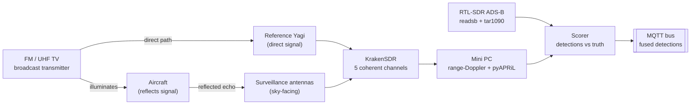
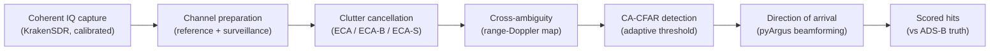

# Sky: Passive Aerial Early-Warning Node

Written by [Taki Sadik](https://tyfsadik.org/about.html) · Last updated 2026-10-22 · 31 min read

A receive-only passive radar node built on a KrakenSDR five-channel coherent SDR: it listens to reflections of existing FM and UHF TV broadcasts bouncing off aircraft, computes range-Doppler plots with pyAPRiL, and scores every detection against an RTL-SDR ADS-B ground-truth receiver. The radar front end is receive-only: it emits nothing of its own.

## Overview

Canada's **Arctic Over-the-Horizon Radar** (A-OTHR), based on Australia's JORN design, adapted for RCAF/NORAD, with initial capability due December 2029, will provide long-range early-warning coverage of the northern approaches as one layer in a sensor picture that also includes conventional radar, airborne, and space-based sensors. Its companion program, **Crossbow**, is a classified Canada-US non-radar sensor network. You can't copy Crossbow, and you shouldn't try.

What you *can* build is the open, hobby-scale, receive-only analogue: a **passive radar node**. Instead of transmitting its own pulses, passive radar listens to reflections of existing broadcast signals, FM radio (88-108 MHz) and UHF TV (~470-600 MHz), bouncing off aircraft. Because the radar front end only receives, it needs no transmit licence, radiates nothing of its own to give away a position, and is cheap. The export-control and intercept-law checks that still apply are covered in the notes at the bottom. A KrakenSDR gives me five phase-coherent receive channels, which is enough to point one antenna at the broadcast transmitter (the **reference** channel) and the rest at the sky (the **surveillance** channels), then cross-correlate the two to find echoes.

This is Phase 1 of my [Canadian Defence Hardware Program](https://github.com/TYFSADIK/defence-hardware-program). It is the flagship sky-domain node: every detection it makes will eventually publish over MQTT into the multi-domain common operating picture, fused with the water and ground nodes.

## Bill of Materials

| Part | Role | Details | Est. US\$ |
|----|----|----|----|
| KrakenSDR | Coherent radar receiver | 5-channel coherent receiver, 24 MHz to 1766 MHz, 2.56 MHz max channel bandwidth (2.4 MS/s is the stable operating sample rate) | 749 (price listed on the KrakenRF product page; confirm before ordering) |
| Antennas | Direction-finding array | KrakenRF 5-antenna set for testing | 199 |
| Directional antennas | Reference and surveillance channels | 2 Yagi / log-periodic for FM and UHF TV reference/surveillance | 80-160 |
| Compute | Processing and truth logging | Mini PC (Intel N100 or i5, 16 GB) running Ubuntu | 150-250 |
| ADS-B truth | Independent ground truth | RTL-SDR Blog V4, 1090 MHz antenna, coax | 50-80 |
| RF accessories | Connections and front end | SMA adapters, low-loss coax, optional FM/UHF filter or LNA | 60-100 |
| NanoVNA (optional) | Antenna tuning | Vector network analyzer for tuning the Yagis | 50-70 |

Total lands around **US\$1,350-1,600** at the current KrakenSDR price. I started with just the ADS-B kit (~US\$100) so the ground-truth logging was collecting data weeks before the KrakenSDR processing chain existed.

## RF & Signal Chain

How the boxes actually connect on the bench. The two SDRs are deliberately on separate USB controllers, one saturated USB bus dropping samples is enough to ruin a coherent capture (see [Troubleshooting](#troubleshooting)).

| From | To | Cable / interface | Notes |
|----|----|----|----|
| FM Yagi (pointed at transmitter) | KrakenSDR CH1 (reference) | LMR-240 coax, SMA | Clean direct-path signal; keep this run short |
| Surveillance antennas (log-periodic / whips) | KrakenSDR CH2-CH5 | Matched-length coax, SMA | Cable lengths matched so phase calibration stays valid |
| KrakenSDR | Mini PC | USB 3.0 data + USB-C 5 V power | Dedicated USB port; quality power supply matters for coherence |
| 1090 MHz antenna | RTL-SDR Blog V4 | Coax, SMA | Mounted as high and clear as the room allows |
| RTL-SDR Blog V4 | Mini PC | USB 2.0 | Separate USB bus from the KrakenSDR |
| Mini PC | LAN / MQTT broker | Gigabit Ethernet | chrony NTP sync so radar and ADS-B timestamps agree |
| Mini PC | Laptop (monitoring) | SSH / HTTP over LAN | tar1090 map and range-Doppler plots viewed here |

Every cable on the receive side; nothing on this node ever transmits.

## Architecture

Figure 1: the transmitter is someone else's; the node only receives. Reference and surveillance channels cross-correlate into range-Doppler detections, which are scored against independent ADS-B truth before publishing to the fusion bus.

## How Passive Radar Processing Works

A passive radar never ranges by time of flight of its own pulse; it measures how much **longer** the aircraft's echo path is than the direct path. The reference Yagi records the broadcast waveform straight from the transmitter; the surveillance antennas record the sky, which contains the same waveform delayed by the extra transmitter-to-aircraft-to-receiver distance, plus shifted in frequency by the aircraft's Doppler. Cross-correlating the two recordings over a bank of Doppler shifts produces the range-Doppler map: every aircraft shows up as a bright peak at its bistatic range (the extra path length) and its Doppler.

The loudest thing on that map is never an aircraft: it is the **direct path** and the ground clutter, both sitting on the zero-Doppler ridge. Extended clutter cancellation (ECA, which pyAPRiL provides alongside its ECA-B and ECA-S variants) estimates and subtracts that ridge before detection, which is why the pipeline can see a small echo next to a mountain of clutter. Range resolution follows the bandwidth: the theoretical figure for passive radar is *c / B*, excess path length (the *c / 2B* figure is the monostatic range convention), about 1500 m for a 200 kHz FM station and about 50 m for a 6 MHz ATSC TV channel, which is exactly why the build compares both illuminators (T3 vs T4).

**Figure:** why the build compares illuminators: bandwidth sets the best-case bistatic range resolution (the speed of light over the bandwidth, c / B, the passive-radar excess-path convention). TV's 6 MHz channel resolves about 50 m where FM manages about 1500 m; away from the transmitter-receiver baseline the bistatic angle degrades this further, and real performance follows from the T3/T4 scoring runs.

Figure: the offline pipeline the build follows, mirroring pyAPRiL's modules: prepare the channels, cancel the clutter ridge, correlate into a range-Doppler map, detect adaptively, estimate direction, then score against the ADS-B log.

## How I Built It

Before any radar work, I put up the truth receiver: an RTL-SDR Blog V4 with a 1090 MHz antenna, decoding Mode S / ADS-B with readsb (the maintained fork of dump1090) and serving a live map with tar1090. The decoder writes aircraft state, ICAO24, position, altitude, heading, speed, to `/run/readsb/aircraft.json` every second, and tar1090 archives rolling history under `/run/tar1090/`. This log is the scoring key for everything that follows: for any timestamp I can say exactly which cooperative aircraft were actually overhead and where.

Both services install from wiedehopf's one-liners on the mini PC's Ubuntu install, and they survive reboots via systemd:

**Installing the ads-b decoder and live map**

    sudo bash -c "$(wget -O - https://raw.githubusercontent.com/wiedehopf/adsb-scripts/master/readsb-install.sh)"
    sudo bash -c "$(wget -O - https://raw.githubusercontent.com/wiedehopf/tar1090/master/install.sh)"
    systemctl status readsb tar1090
    # sanity check: how many aircraft are being decoded right now?
    curl -s http://127.0.0.1/tar1090/data/aircraft.json | jq '.aircraft | length'

**How I verified:** the tar1090 map at `http://mini-pc:8080/` (this build's deployment choice) showed live tracks matching what I could hear on approach frequencies, and `aircraft.json` updated every second. What can go wrong: a badly sited 1090 antenna gives you five aircraft and a false sense of failure later, I moved it to a window with sky view before trusting the log.

Passive radar is only as good as its illuminators of opportunity, so before mounting anything directional I mapped my local broadcast landscape with `rtl_power`: which FM stations (88-108 MHz) and UHF TV transmitters (~470-600 MHz, ATSC) are receivable here, at what power, and on which exact frequencies. FM offers long range and strong signals; 8-VSB/ATSC TV has more bandwidth and therefore better range resolution. I cross-checked the strongest peaks against public transmitter databases to get each station's location, the bistatic geometry later depends on knowing precisely where the transmitter is.

**Band surveys with rtl_power**

    # FM broadcast band: 200 kHz bins, 5 minutes of integration
    rtl_power -f 88M:108M:200k -i 10 -c 50% -e 5m -g 40 fm_survey.csv

    # UHF TV band: 1 MHz bins
    rtl_power -f 470M:608M:1M -i 10 -c 50% -e 5m -g 40 uhf_survey.csv

    # render a quick heatmap to eyeball the strongest transmitters
    python3 heatmap.py fm_survey.csv fm_survey.png

**What can go wrong:** the strongest station is not always the best illuminator, one 100 kW FM station a few kilometres away saturated the front end and created intermod products across the band (see [Troubleshooting](#troubleshooting)). I picked illuminators that are strong but not co-located with my receiver.

A passive radar lives on faint echoes, so every dB lost to a mistuned antenna hurts twice (once on the reference, once on the echo). I swept the FM Yagi and the UHF log-periodic with the NanoVNA from the bench using NanoVNASaver, checking SWR across each target band and trimming the Yagi's driven element until the dip sat inside the FM band rather than at its edge. Target: SWR under 2:1 across the whole illuminator band, ideally under 1.5:1 at the chosen station's frequency.

**Nanovnasaver setup on ubuntu**

    sudo apt install python3-pyqt5 libxcb-xinerama0
    pip3 install nanovna-saver
    NanoVNASaver   # connect the VNA over USB, calibrate open/short/load first

**How I verified:** after tuning, the reference-channel spectrum in the KrakenSDR UI showed the target station several dB stronger than before, and the survey peaks matched step 02's expectations. What can go wrong: tuning indoors lies, the SWR dip moved when the antenna went up near metal, so I re-swept it in its final position before sealing the coax.

The KrakenSDR is five RTL-SDR-class receivers in one box sharing one clock, covering 24-1766 MHz, the shared clock is what keeps all channels phase-aligned, which is the whole point for passive radar and direction finding. I run the open-source `krakensdr_doa` stack (HeIMDALL DAQ firmware plus the DSP/web layer) on the mini PC; a Raspberry Pi 4/5 works too, but the x86 box has the headroom for the processing chain in later steps.

**Installing and starting the krakensdr stack**

    git clone https://github.com/krakenrf/krakensdr_doa.git
    cd krakensdr_doa
    # the DAQ launch script must be copied out of the firmware util directory
    # into the repo root before the start script can find it (per repo README):
    cp heimdall_daq_fw/util/heimdall_daq_fw_run.sh .
    # install dependencies per the repo README for your platform, then:
    ./kraken_doa_start.sh   # starts the HeIMDALL DAQ core + DSP + web UI
    ./kraken_doa_stop.sh    # clean shutdown between config changes

The web UI comes up on port 8081 on this build; from there I set the centre frequency to the chosen FM station, set gain, and confirmed all five channels streaming.

**What can go wrong:** undervoltage on the USB-C power line causes random channel drops that look exactly like software bugs. I power the KrakenSDR from a proper 5 V supply, not a hub port, and check `dmesg` for USB resets after any weird behaviour.

Five receivers sharing a clock are frequency-coherent, but each channel still has its own phase and amplitude offset from mixer and path differences. The KrakenSDR's built-in noise source injects a common wideband signal into all five channels, and the software measures and nulls those offsets. The critical operational rule: frequency and gain changes trigger Kraken recalibration, and any retune or sample-rate change invalidates the phase calibration, so **recalibrate on every retune or sample-rate change** and it must be re-run. I log the calibration timestamp alongside every capture so I can prove later that a capture was taken in a calibrated state.

**Daq configuration (key fields) and calibration flow**

    # _daq_core/daq_chain_config.ini - key fields for an FM illuminator
    [daq]
    center_freq = 98.1        # MHz - the chosen FM station
    # legacy _daq_core/daq_chain_config.ini uses MHz; native v2 control examples use Hz
    sample_rate = 2400000     # Hz
    uniform_gain = 40.2         # dB, all channels
    # Then in the web UI (http://mini-pc:8081):
    #   1. enable the noise source  2. run calibration  3. disable noise source
    #   4. confirm per-channel phase offsets read near zero

**How I verified:** with the noise source on, the calibrated channels report near-zero residual phase spread; a deliberately skipped calibration shows up immediately as garbage correlation. This failure mode, silently uncalibrated captures, is exactly why the timestamp logging exists.

**Port note (documented workaround):** tar1090 keeps port 8080 on this build, so the KrakenSDR web UI runs on port 8081. Both tools commonly come up on 8080 in their stock installs, so confirm the actual deployed ports on your own build if you follow these steps.

Two antenna roles carry the radar geometry. The **reference** Yagi points at the broadcast transmitter and captures the clean direct signal on channel 1. The **surveillance** antennas point at the area of interest on channels 2-5 and capture that same signal delayed and Doppler-shifted by aircraft reflections. Spacing between surveillance elements matters for direction-of-arrival work: the rule of thumb is half-wavelength spacing to avoid grating lobes, which is band-dependent, at FM frequencies the elements sit far apart, at UHF TV they pack tightly.

**Element spacing per band**

    python3 - <<'EOF'
    c = 299792458
    for f in (98.1e6, 550e6):
        lam = c / f
        print(f"{f/1e6:6.1f} MHz: lambda = {lam:.2f} m, half-lambda = {lam/2:.2f} m")
    EOF
    #  98.1 MHz: lambda = 3.06 m, half-lambda = 1.53 m
    # 550.0 MHz: lambda = 0.55 m, half-lambda = 0.27 m

I also placed the reference antenna so its pattern nulls toward the surveillance array, direct-path breakthrough leaking into the surveillance channels is the number-one enemy of a small passive radar.

**What can go wrong:** at FM wavelengths the "array" is over a metre per element, so my first indoor layout had the elements coupled to each other and to the room. Moving the surveillance antennas away from walls and large metal objects visibly cleaned up the clutter floor.

Processing development needs repeatable data, so before tuning anything live I built a recorder that pulls synchronized IQ frames from the HeIMDALL DAQ's network IQ interface (the same output the KrakenSDR mobile app consumes) and writes per-channel interleaved float32 files plus a small JSON sidecar with centre frequency, sample rate, gain, and calibration timestamp. The DAQ speaks framed MCHQ packets on that interface (magic, big-endian header with per-channel frequency and gain, then interleaved uint8 IQ), so the real recorder parses frames and converts to float32; the socket snippet below is schematic. A 10-30 second capture at 2.4 MHz sample rate is a few hundred MB across five channels, big enough to develop against, small enough to keep a library of.

**Record_iq.py (simplified capture loop; pseudocode, cannot parse mchq headers directly)**

    import json, socket, time
    import numpy as np

    # NOTE: pseudocode. The DAQ sends framed MCHQ packets (magic, big-endian
    # header with per-channel frequency and gain, then interleaved uint8 IQ);
    # the real recorder parses each frame header first and converts the CU8
    # payload to float32. This sketch reads raw complex64 for illustration.
    N_CH, N_SAMPLES = 5, 1 << 22          # ~1.7 s per CPI block at 2.4 MHz
    sock = socket.create_connection(("127.0.0.1", 5000))   # DAQ IQ interface

    def read_exact(n):
        buf = b""
        while len(buf) < n:
            buf += sock.recv(n - len(buf))
        return buf

    stamp = int(time.time())
    raw = read_exact(N_CH * N_SAMPLES * 2 * 4)             # complex float32
    iq = np.frombuffer(raw, dtype=np.complex64).reshape(N_CH, N_SAMPLES)
    iq.tofile(f"captures/iq_{stamp}.cf32")
    json.dump({"fc_hz": 98.1e6, "fs_hz": 2.4e6, "gain_db": 40.2,
               "cal_ts": last_calibration_ts},
              open(f"captures/iq_{stamp}.json", "w"))

**How I verified:** every capture gets opened in a waterfall before being filed, a capture with USB dropouts shows visible streaks and gets deleted, because training a clutter filter on corrupted data wastes days.

The core DSP runs on **pyAPRiL**, the open-source Python passive-radar library on PyPI (`pip install pyapril`). KrakenRF's own ready-to-use passive radar code was withdrawn for regulatory reasons, so this chain is built on pyAPRiL instead of any Kraken-distributed implementation. The chain per coherent processing interval (CPI): prepare the reference and surveillance channels, suppress the direct-path breakthrough and stationary clutter with an adaptive filter (the ECA family, Extensive Cancellation Algorithm), compute the cross-ambiguity surface (surveillance correlated against reference over a bank of Doppler shifts), and run CA-CFAR detection over the resulting range-Doppler map. Aircraft appear as peaks at a bistatic range (extra path length vs the direct signal) and a Doppler speed. With multiple surveillance channels calibrated, pyAPRiL also estimates direction of arrival, which turns a blip into a bearing.

**Rd_pipeline.py, one cpi through the chain (simplified wrapper pseudocode, not verbatim pyapril api)**

    import numpy as np

    ref  = load_cf32("iq_1695600000.cf32")[0]     # channel 1: reference
    surv = load_cf32("iq_1695600000.cf32")[1]     # channel 2: surveillance

    # 1. ECA clutter cancellation: project direct path + static clutter out
    surv_clean = eca_filter(ref, surv, n_filter_taps=10)

    # 2. cross-ambiguity: bistatic range vs Doppler
    rd_map = cross_ambiguity(ref, surv_clean, fs=2.4e6,
                             max_doppler_hz=600, cpi_s=0.5)

    # 3. CA-CFAR hit detection over the range-Doppler surface
    hits = ca_cfar(np.abs(rd_map), guard=2, train=8, pfa=1e-4)

**What can go wrong:** the call names below are simplified wrappers showing the processing order, consult the installed pyAPRiL release for the exact API. With insufficient clutter cancellation the zero-Doppler ridge swamps everything and CFAR declares hundreds of false hits, the tuning loop is filter order vs false-alarm rate, judged on recorded captures before ever running live. Memory is the other constraint: full CPI surfaces accumulate fast, which is why the mini PC has 16 GB.

A radar page without numbers is marketing, so the scoring harness is a first-class part of the build. For each logged ADS-B aircraft at each capture timestamp, I compute where it *should* appear in bistatic range-Doppler space, the extra path length via the known transmitter location, and the Doppler from its velocity projected onto the transmitter-aircraft and aircraft-receiver legs, then check whether the radar produced a CFAR hit there, and whether it produced hits where no aircraft existed. That yields the three numbers that define the radar: detection rate, false-alarm rate, and effective range per illuminator. FM and UHF TV get scored separately, because the honest answer is usually "it depends on the transmitter."

**Score_run.py, aligning detections with truth (simplified)**

    import glob, json
    import pandas as pd

    truth = pd.concat(pd.read_json(f)
                      for f in sorted(glob.glob("adsb_history/*.json")))
    hits  = pd.read_json("captures/run_012_hits.json")   # CFAR hits, this run

    for _, ac in truth[truth.run_id == RUN_ID].iterrows():
        bistatic_r = extra_path(tx_pos, ac.pos, rx_pos)  # known TX + RX sites
        doppler    = bistatic_doppler(tx_pos, ac, rx_pos)
        hit = hits.query("abs(range_m - @bistatic_r) < TOL_R and "
                         "abs(doppler_hz - @doppler) < TOL_D")
        record(ac.icao24, detected=not hit.empty)

**How I verified:** the harness is only trustworthy if its clock is, both the ADS-B log and the captures come off the same chrony-disciplined mini PC, and I reject any run where the truth log has gaps in the scoring window.

A sensor node you have to babysit is a demo, not a node. The DAQ, recorder, and processing chain run as a systemd service that starts on boot and restarts on failure; captures and score summaries rotate to the archive disk nightly. The endgame is 2-3 nodes at different sites publishing detections over MQTT, the same signed-detections bus the rest of the hardware program uses, into the [multi-domain common operating picture](https://github.com/TYFSADIK/multi-domain-common-operating-picture), where intersecting range-Doppler-DoA solutions from multiple nodes become actual positions. Store-and-forward applies here too: nodes buffer through dead links and sync on reconnect, the DDIL pattern the rest of the program is built around.

**/etc/systemd/system/sky-node.service**

    [Unit]
    Description=Sky passive radar node (HeIMDALL DAQ + processing)
    After=network-online.target

    [Service]
    User=taki
    WorkingDirectory=/home/taki/sky-node
    ExecStart=/home/taki/sky-node/run_node.sh
    Restart=always
    RestartSec=10

    [Install]
    WantedBy=multi-user.target

**Publishing a detection to the fusion bus**

    import json, paho.mqtt.client as mqtt

    client = mqtt.Client("sky-node-01")
    client.connect("cop-broker.local", 1883)
    client.publish("defence/sky/detections", json.dumps({
        "node": "sky-node-01", "ts": capture_ts,
        "range_m": bistatic_r, "doppler_hz": doppler, "doa_deg": bearing,
    }), qos=1)

**What can go wrong:** a node that silently stops publishing looks identical to empty sky. The service logs a heartbeat metric, and the COP side flags any node that goes quiet, the same health-check discipline as any production fleet.

## What CA-CFAR Does

After clutter cancellation, the range-Doppler map still has lumps: residual clutter, noise, and the aircraft peaks hiding in it. A **fixed threshold** cannot survive that landscape: set it low and every clutter lump is a false alarm; set it high and the quiet aircraft vanish. Cell-averaging constant false alarm rate (CA-CFAR, the detector pyAPRiL's hit processor provides) sets a different threshold for every cell of the map. For the cell under test it averages the energy of neighboring **training cells**, skips the immediately adjacent **guard cells** (so a real target's own energy does not pollute its threshold), multiplies by a scale factor chosen for the target false-alarm probability, and declares a hit only if the test cell exceeds it. The false-alarm rate stays roughly constant even as clutter and noise drift, which is exactly what the T5 overnight soak measures.

## Testing & Metrics

The protocol is built around the ADS-B ground truth, and every run is logged with its configuration (illuminator, gain, filter order, calibration timestamp) so results are reproducible rather than anecdotal. Each numbered run below is a repeatable procedure; runs get re-executed after any antenna, gain, or filter change.

### Test runs

1.  **T1, ADS-B truth completeness.** Setup: readsb/tar1090 running for a full week. Procedure: count daily decoded aircraft and check the history files for gaps. Metric: log uptime and messages/second. This has to be solid first, every later score inherits its errors.
2.  **T2, Calibration hold time.** Setup: KrakenSDR calibrated, then left streaming untouched. Procedure: re-check residual phase spread between channels at increasing intervals without recalibrating. Metric: time until range-Doppler quality measurably degrades. Output: the re-calibration interval the node enforces in software.
3.  **T3, FM illuminator detection run.** Setup: reference Yagi on the chosen FM station, surveillance antennas on the approach corridor, fresh calibration. Procedure: record captures across several busy traffic windows, process with the fixed pipeline, score against the truth log. Metric: detection rate per range band, and false alarms per hour.
4.  **T4, UHF TV illuminator comparison.** Setup: identical to T3 but on an ATSC transmitter. Procedure and metrics identical, the point is a per-illuminator comparison, because bandwidth and transmitter geometry differ.
5.  **T5, False-alarm soak.** Setup: pipeline running with CFAR at its working threshold during a quiet-traffic window (overnight). Procedure: count hits with no matching ADS-B track. Metric: false alarms per hour; this is what clutter-filter tuning is judged on.
6.  **T6, Multi-node dry run.** Setup: planned second node on the same illuminator. Procedure: both nodes record simultaneously, fuse detections over MQTT, and compare the intersected position with ADS-B truth. Metric: position error vs single-node geometry. Status: pending the second node.

### Targets, Measured Evidence, and Current Status

Evidence and targets are kept separate: the "measured to date" column holds only what has actually been recorded, and the target column holds what the build is aiming at.

| Metric | Target | Measured to date | Current status |
|----|----|----|----|
| ADS-B truth log uptime | \> 95% over any scoring week | Running; uptime tracked, scoring weeks being selected | Running; uptime tracked, scoring weeks being selected |
| Detection rate (FM illuminator) | \> 70% of ADS-B tracks in the primary coverage band | Not yet measured | In progress, T3 runs underway, not yet scored |
| Detection rate (UHF TV illuminator) | Comparable to FM within its coverage band | Not yet measured | Not yet measured, T4 pending |
| False-alarm rate | \< 10 per hour at the working CFAR threshold | Not yet measured | In progress, clutter filter still being tuned |
| Effective bistatic range | Establish per illuminator, then publish | Not yet measured | Not yet measured, follows from T3/T4 |
| Calibration hold time | Quantify, then automate re-calibration on that interval | Not yet measured | In progress, T2 data being collected |
| Multi-node position error | Meaningfully better than single-node geometry | Not yet measured | Not started, second node not yet built |

**Results are in progress and not yet published.** The ADS-B truth log has been accumulating since the receiver went live; the range-Doppler chain is producing plots on the bench, and the scored detection/false-alarm dataset will be published once I have enough scored hours per illuminator to make the numbers meaningful. I am deliberately not quoting range or detection-rate figures until then.

## Legal & Safety Notes

**Export control:** the KrakenSDR team once pulled its passive-radar code because it appeared to fall under an export-control category covering passive radar. Before publishing radar code, I check Canada's export control rules with Global Affairs Canada, or publish only the write-up, the data, and the metrics. Handling that carefully is itself a good signal to security reviewers.

**Receive-only:** everything on this node receives; it never transmits. Jamming is illegal in Canada, and nothing here is capable of interfering with any signal, it only listens to broadcasts that already exist.

## Troubleshooting & Lessons

- **USB dropouts ruining coherent captures.** Symptom: streaks across the waterfall and correlation that dies mid-CPI. Cause: both SDRs streaming through one overloaded USB controller, and an undervolted KrakenSDR. Fix: separate USB buses for the KrakenSDR and the RTL-SDR, a quality 5 V supply, short good cables, and `dmesg -w` watching for xHCI errors during every capture. Any capture with a dropout gets deleted, not processed.
- **Range-Doppler map is all clutter ridge, no aircraft.** The direct-path signal leaking into the surveillance channels was stronger than the echoes by orders of magnitude. Fixes, in the order that worked: physically separate and null the antennas (reference pattern null toward the surveillance array), then raise the ECA filter order in the processing chain, then confirm the calibration was current. If the zero-Doppler ridge still dominates, the geometry, not the code, is the problem.
- **Coherence "randomly" lost after working an hour ago.** Not random: frequency and gain changes trigger Kraken recalibration, and any retune or sample-rate change invalidates phase calibration. Fix: treat calibration as part of the run configuration, re-run it on every change, and log its timestamp with every capture so stale-calibration data can be filtered out of scoring.
- **A nearby powerhouse FM station saturating the front end.** A very strong local transmitter raised the noise floor across the band and produced intermod ghosts. Fix: back the gain down (coherence matters more than gain), pick an illuminator that is strong-but-distant, and if needed put an FM band-stop filter on the surveillance channels only, never on the reference.
- **Detections that don't line up with ADS-B truth.** First suspect was the algorithm; the actual cause was clock disagreement between the radar captures and the truth log, a few seconds of drift moves a fast aircraft well outside the tolerance window. Fix: chrony on the mini PC disciplining both pipelines off NTP, and a scoring-harness check that rejects runs where the truth log has gaps.

## Status & Roadmap

- **Done**: full BOM purchased and on the bench; ADS-B ground-truth receiver (readsb + tar1090) live with continuous position logging; FM and UHF TV illuminator survey with rtl_power; Yagi and log-periodic tuned with the NanoVNA; KrakenSDR streaming coherent IQ with the calibration discipline (recalibrate on every retune) in place; capture recorder writing CF32 plus metadata sidecars.
- **In progress**: pyAPRiL range-Doppler chain with ECA clutter filtering tuned against recorded captures; the T2 calibration-hold and T3 FM detection test runs; the scoring harness that aligns CFAR hits with the ADS-B truth log.
- **Next**: finish the T3-T5 scoring runs and publish the per-illuminator dataset (detection rate, false-alarm rate, effective range); systemd-managed always-on node with MQTT publishing; second node and the T6 multi-node fusion dry run into the common operating picture; export-control review with Global Affairs Canada before any radar code is published.

## Related Builds

- [Multi-Domain Common Operating Picture](https://github.com/TYFSADIK/multi-domain-common-operating-picture), where this node's detections end up: fused with the water and ground nodes over MQTT with a human deciding.
- [Passive Acoustic Drone Detector](https://github.com/TYFSADIK/acoustic-drone-detector), the other receive-only sky sensor in the program, listening for rotor harmonics instead of RF reflections.
- [Arctic Domain Awareness Digital Twin](https://github.com/TYFSADIK/arctic-domain-awareness), the same fusion problem over open ADS-B, AIS, and satellite data at Arctic scale.
- [Canadian Defence Hardware Program](https://github.com/TYFSADIK/defence-hardware-program), the program hub with all builds, phased BOMs, and Canada-specific notes.

## Build Narrative: Phase by Phase

**Phase 1: truth before radar.** I built the ADS-B ground-truth receiver first: an RTL-SDR Blog V4 with a 1090 MHz antenna running readsb and tar1090, logging aircraft positions continuously. A passive radar without independent truth is unverifiable, so the truth pipeline had to exist weeks before any radar processing ran.

**Phase 2: illuminator survey.** Using rtl_power I swept the FM band (88-108 MHz) and the UHF TV band (~470-600 MHz) from the bench, cataloguing candidate illuminators by signal strength and geometry. This is also where the local FM powerhouse showed up, the one strong enough to saturate the front end, which became a design input rather than a surprise.

**Phase 3: antennas and geometry.** I built the FM Yagi aimed at the chosen transmitter as the reference channel, with log-periodic and whip surveillance antennas on matched-length coax, all tuned with the NanoVNA. Physical separation and pattern nulling were used to keep the direct-path signal from overwhelming the echoes in the surveillance channels.

**Phase 4: coherent capture discipline.** The KrakenSDR went onto the Ubuntu mini PC with the RTL-SDR deliberately on a separate USB bus, powered by a quality 5 V supply. Calibration is treated as part of the run configuration and re-run on every retune, since frequency and gain changes trigger Kraken recalibration. The capture recorder writes CF32 IQ plus metadata sidecars, with chrony NTP keeping radar and truth timestamps in agreement.

**Phase 5: processing and scoring.** The pyAPRiL chain cross-correlates reference and surveillance channels into range-Doppler maps, an ECA filter suppresses the zero-Doppler clutter ridge, and a CA-CFAR detector proposes hits. The scoring harness then aligns those hits against the ADS-B truth log inside a tolerance window, producing measured detection and false-alarm rates per illuminator.

## What You Need

Everything below mirrors the bill of materials on this page. The single non-obvious requirement is patience with calibration: the whole build assumes you re-calibrate on every configuration change.

| Category | Item | Notes |
|----|----|----|
| Hardware | KrakenSDR | 5-channel coherent SDR, 5x R820T2 tuners, 24 MHz to 1766 MHz, 2.56 MHz channel bandwidth, ~11 W at 5 V |
| Hardware | Reference + surveillance antennas | FM Yagi for the reference channel, log-periodic/whip surveillance antennas, matched-length coax, NanoVNA for tuning |
| Hardware | Mini PC (Ubuntu) | Intel N100/i5 class with 16 GB RAM; keep the two SDRs on separate USB controllers |
| Hardware | RTL-SDR Blog V4 + 1090 MHz antenna | The ADS-B ground-truth receiver; its data is what makes every radar result scoreable |
| Software | KrakenSDR DAQ/DSP + pyAPRiL | Open-source KrakenRF software for capture, pyAPRiL for range-Doppler processing |
| Software | readsb + tar1090, rtl_power | Aircraft truth map and spectrum survey tooling, both free |
| Software | chrony, Python/numpy/scipy | NTP time discipline for truth alignment, numerical stack for the chain |
| Skills | RF fundamentals, Linux, Python DSP | dB arithmetic, gain staging, reading waterfall plots, coherent vs non-coherent captures |
| Accounts | None for receive-only | No accounts or licenses needed; export-control review with Global Affairs Canada is required before publishing radar processing code |

## Challenges and Lessons Learned

- **USB dropouts ruined coherent captures.** Streaked waterfalls and dying correlation traced to both SDRs sharing one overloaded USB controller plus an undervolted KrakenSDR. Lesson: give streaming SDRs separate buses and watch `dmesg -w` for xHCI errors during every capture; any capture with a dropout gets deleted, not processed.
- **The zero-Doppler clutter ridge buried everything.** Direct-path leakage into the surveillance channels was orders of magnitude stronger than echoes. Lesson: fix geometry first (antenna separation and nulling), then raise the ECA filter order, then confirm calibration. If the ridge still dominates, the geometry, not the code, is the problem.
- **Coherence died on every retune.** Frequency and gain changes trigger Kraken recalibration, and any retune or sample-rate change invalidates phase calibration. Lesson: calibration is part of the run configuration, and every capture gets its calibration timestamp so stale-calibration data can be filtered out of scoring.
- **Clock drift masqueraded as algorithm error.** Detections that did not line up with ADS-B truth turned out to be chrony/NTP disagreement between pipelines, a few seconds of drift moves a fast aircraft outside the tolerance window. Lesson: discipline time before debugging math.

## What Is Next

- Finish the T3 to T5 scoring runs and publish the per-illuminator dataset: detection rate, false-alarm rate, and effective range, all scored against ADS-B truth (measured results only, no targets dressed as data).
- Systemd-managed always-on node publishing scored detections over MQTT into the common operating picture.
- A second KrakenSDR node and the T6 multi-node fusion dry run, testing whether two receive-only nodes see the same aircraft consistently.
- Export-control review with Global Affairs Canada before any radar processing code is published, and only then.
- Evaluate ATSC illuminators for finer range resolution at higher frequencies, weighed against their weaker power density compared with FM.

## Frequently Asked Questions

Symptom: streaks across the waterfall and correlation that dies mid-CPI. Cause: both SDRs streaming through one overloaded USB controller, and an undervolted KrakenSDR. Fix: separate USB buses for the KrakenSDR and the RTL-SDR, a quality 5 V supply, short good cables, and dmesg -w watching for xHCI errors during every capture. Any capture with a dropout gets deleted, not processed.

The direct-path signal leaking into the surveillance channels was stronger than the echoes by orders of magnitude. Fixes, in the order that worked: physically separate and null the antennas (reference pattern null toward the surveillance array), then raise the ECA filter order in the processing chain, then confirm the calibration was current. If the zero-Doppler ridge still dominates, the geometry, not the code, is the problem.

Not random: frequency and gain changes trigger Kraken recalibration, and any retune or sample-rate change invalidates phase calibration. Fix: treat calibration as part of the run configuration, re-run it on every change, and log its timestamp with every capture so stale-calibration data can be filtered out of scoring.

A very strong local transmitter raised the noise floor across the band and produced intermod ghosts. Fix: back the gain down (coherence matters more than gain), pick an illuminator that is strong-but-distant, and if needed put an FM band-stop filter on the surveillance channels only, never on the reference.

First suspect was the algorithm; the actual cause was clock disagreement between the radar captures and the truth log, a few seconds of drift moves a fast aircraft well outside the tolerance window. Fix: chrony on the mini PC disciplining both pipelines off NTP, and a scoring-harness check that rejects runs where the truth log has gaps.

## Cite This Page

**Plain text**

    Taki Sadik, "Sky: Passive Aerial Early-Warning Node", TYFSADIK, https://github.com/TYFSADIK/sky-passive-radar-node (accessed 2026-10-22).

**BibTeX**

    @misc{sadik-sky-passive-radar-node,
      author  = {Sadik, MD. Taki Yasir Faraji},
      title   = {Sky: Passive Aerial Early-Warning Node},
      year    = {2026},
      url     = {https://github.com/TYFSADIK/sky-passive-radar-node},
      urldate = {2026-10-22}
    }

**APA**

    Sadik, M. T. Y. F. (2026). Sky: Passive Aerial Early-Warning Node. TYFSADIK. https://github.com/TYFSADIK/sky-passive-radar-node

---

Original page: <https://github.com/TYFSADIK/sky-passive-radar-node>
